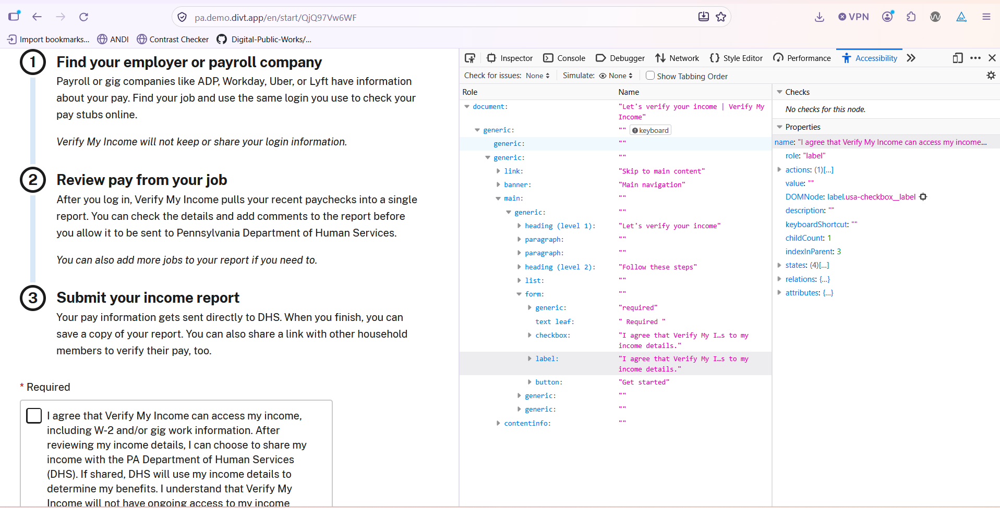

# Best Practices by Role

Reference checklists for accessibility considerations, organized by who's most likely to act on them day-to-day. These aren't gated by role, anyone can and should read the others, but each is written with a specific audience in mind.

## Design & UX

* **Same or similar UX.** User interactions should be equivalent, no matter how a user is engaging with the page. We want to avoid creating a separate pattern for assistive technologies.
* **Reuse.** Use existing USWDS or in-house components before creating new patterns.
* **Name, role, value, state** should be captured in the ticket Requirements for custom or non-native components. Name/Role are required, while Value and State may be optional depending on context.
  * **Name** — what the element is called for someone who can't see it or for speech input users to direct their AT towards.
  * **Role** — the control type (toggle, button, tab, combobox, etc.).
  * **Value** — the current content/selection an assistive technology should report, where applicable.
  * **States** — expanded/collapsed, selected, disabled, on/off, etc. A custom toggle needs a stated on/off state conveyed programmatically, not just a color change in the mock.
* **Color and contrast.** Meets contrast minimums, and never the only way information or state is conveyed (e.g., an error or "selected" state needs more than a color change).
* **Visible focus.** Every interactive element needs a clear, designed focus indicator — not just whatever the browser default happens to be, and not removed for aesthetics.
* **Zoom and reflow.** Layouts should hold up with larger text/zoom, not just at one fixed size. Text must scale to 200% zoom without assistive technology and without loss of content or functionality. At 400% zoom (or 320 pixels) layouts should not require horizontal scrolling.
* **Touch targets.** Interactive elements sized and spaced generously enough to hit reliably (roughly 44x44px as a rule of thumb).
* **Errors and messaging.** Error states should be specific, tied to the field they describe, and not rely on color alone — this is what engineering implements via `aria-describedby` (see [Best Practices by Role → Engineering](#engineering)), so the copy and placement need to be designed with that in mind.
* **Motion.** Avoid content where essential information is conveyed only through animation or auto-advancing/auto-playing elements; respect reduced-motion preferences.
* **Non-text content.** For every image/icon, indicate whether it's meaningful (needs alt text) or purely decorative — engineering can't infer intent from a mock alone.
* **Consistency.** Reusing an established interaction pattern (discoverability, navigation, form flow) elsewhere in the product is itself an accessibility win — novelty has a cost.
* **Don't describe UI by sensory characteristics alone.** Instructions like "click the button on the right" or "select the red option" assume sight and color perception. Refer to labeled names instead ("select Continue").
* **More than one way to complete an interaction.** Don't require a specific gesture, hover, or pointer action with no alternative — e.g., drag-and-drop needs a click/keyboard equivalent, hover-only tooltips need a focus/tap equivalent.
* **Descriptive link and button text.** Avoid vague labels like "Click here" or "Learn more" with no surrounding context — screen reader users frequently scan a page's links/buttons in a list, out of context.
* **Plain language.** Write instructions, labels, and error copy in plain language; this also reduces cognitive load for applicants who may be filling this out under time pressure or on an unfamiliar device.
* **Time limits.** If a flow can time out, design the warning before it happens, not just the aftermath — we already do this well for session timeout (see `app/app/views/cbv/sessions/_timeout_modal.html.erb`), and it's a good reference pattern for any future time-sensitive step. There are currently no specific guidelines around long lasting operations other than general advice to keep the user updated.
* **Error prevention on consequential actions.** For anything hard to undo (e.g., submitting the final report), give the user a clear review/confirm step rather than a single point of no return.
* **Reading and tab order match visual order.** Especially in multi-column or card-based layouts — what looks logical visually should also be logical when read linearly or tabbed through.

## Engineering

The goal here is a practical checklist, not a frontend accessibility primer.

* **Prefer USWDS components over custom markup.** USWDS bakes in a lot of correct-by-default behavior (focus states, keyboard handling, semantics). Reaching for a custom implementation should be the exception, not the default.
  * **Define Properties and Events for custom components.** For any custom or uncommon interaction pattern, explicitly define what properties change (expanded/collapsed, selected, disabled) and what events fire (live-region alerts, focus moves). Don't leave this implicit in the implementation.
* **Semantic HTML first.** A native `<button>`, `<label>`, or `<table>` gets you correct role/keyboard behavior for free. Reach for ARIA only when semantic HTML genuinely can't express the pattern.
  * Semantic elements contain context and meaning for a screen reader. While a div or span might be useful for organization or styling, they provide no information about the content itself. If the content is text, it should be a `
` tag, similarly if it’s a sidebar or indirectly related content, it should be an `<aside>`
  * Style vs Context: Consider the meaning behind the styles. While sometimes the formatting of text is purely cosmetic, if there is a piece of content that is bolded for importance, consider using a `<strong>` tag. If a word or phrase is in italics because it should be read with emphasis, consider using an `<em>` tag. This will change the way a screen reader announces the content and gives users additional auditory context they might miss.
  * Careful of older patterns that used semantic HTML for styling purposes. A common trick in the early web was to use ` ` elements to create a small space between text. While this is how a browser interprets the element, it carries a specific meaning for a screen reader that is usually reserved for poems or addresses where a division line is significant and will create confusion for a user.
  * There are too many useful elements to name here, please see the [MDN Element Reference](https://developer.mozilla.org/en-US/docs/Web/HTML/Reference/Elements) for a full list of HTML5 elements
* **ARIA is a last resort, not a default.** Adding `role`/`aria-*` attributes to a `
` doesn't make it accessible by itself, it makes a promise that the element will behave like that role (keyboard interaction included). Don't add ARIA without also implementing the behavior it implies.
* **Keyboard operability.** Anything clickable must be reachable and operable by keyboard alone: tab order should follow visual/logical order, focus should be visible, and nothing should trap focus
  * *NOTE:* keyboard trap vs keyboard trapping - a keyboard trap is a bug where a user is unable to complete a task because focus gets caught or lost while working through the application. However, it is sometimes necessary to create focus trapping to keep the user contained within a piece of the UI. An example of this would be an open modal. The user focus should wrap around to the top of the modal instead of returning to the screen behind.
* **Announcing dynamic content.** Use the existing `#live-announcer` region and `updateAriaLiveRegion` (`app/app/javascript/utilities/accessibility.js`) for content that changes without a page load, and `toggleErrorIds`/`aria-describedby` for validation errors. Don't introduce a second, competing pattern. Note the existing TODO about race conditions when multiple components call `updateAriaLiveRegion` in quick succession; that's a known rough edge, not new behavior to design around.
* **Color contrast.** Verify contrast on anything with custom colors, not just USWDS defaults. This is worth calling out explicitly, since it's the single most common accessibility failure Microsoft's LLM accessibility evaluation found in generated UI code (89% of failing samples), and it's an easy one to miss by eye.
* **Zoom and reflow.** Layouts should hold up with larger text/zoom, not just at one fixed size. Text must scale to 200% zoom without assistive technology and without loss of content or functionality. At 400% zoom (or 320 pixels) layouts should not require horizontal scrolling.
  * For more information, see [Understanding Resize Text](https://www.w3.org/WAI/WCAG21/Understanding/resize-text.html) or [Understanding Reflow](https://www.w3.org/WAI/WCAG21/Understanding/reflow.html)
* **AI-assisted code generation.** If code (yours or an AI coding agent's) is generated with no accessibility instruction at all, expect it to be wrong by default. Microsoft's evaluation found ~12% baseline pass rates on accessibility checks with no guidance, rising to ~60% with basic instructions, and ~86% with a structured "generate, then self-review against accessibility criteria" workflow.

## QA / Manual Testing

Adapted from the CMS Section 508 IT Developer Toolkit, [§2.3 "Accessibility Check-in Script Checklist"](https://www.cms.gov/files/document/cms-section-508-it-developer-toolkit.pdf), simplified for engineers who aren't accessibility specialists:

1. **Run one in-browser automated checker.** axe DevTools, Accessibility Insights Fast Pass, WebAIM WAVE, or Pa11y — pick one, run it against the page, and review the obvious/confirmed errors it reports ("needs review" items required human judgment, but may not require a code change).
2. **Check color contrast.** Turn on your OS or browser's high-contrast mode and confirm nothing becomes unreadable, and that no element (border, icon, focus ring) disappears entirely.
3. **Spot-check the accessibility tree.** Open your browser's accessibility inspector (the Accessibility pane in developer tools) and look for obvious anomalies: an element's computed name/role not matching what it visually is, or stray/duplicate items in the tree.

   
4. **Keyboard-only pass.** confirm every interactive element is reachable by Tab, focus is visible at every stop, nothing traps focus (you can Tab out of it), tabbing forward and Shift+Tab backward retrace the same path symmetrically.
5. **Screen reader pass, default settings.** Turn on VoiceOver (Mac) or NVDA (Windows) with default settings and confirm: every meaningful element announces something useful, nothing important is skipped, filler/decorative content isn't read aloud, and dynamic updates (form errors, live-region announcements) are actually announced when they happen.
6. **Scan the screen reader's element/command list** for anything that looks wrong at a glance (duplicate labels, missing landmarks, etc.) — this doesn't need to be exhaustive, just a spot check.

## Additional resources

* [CMS Section 508 IT Developer Toolkit](https://www.cms.gov/files/document/cms-section-508-it-developer-toolkit.pdf) — §2.3 checklist adapted in [Best Practices by Role → QA / Manual Testing](#qa--manual-testing).
* [Microsoft a11y-llm-eval](https://github.com/microsoft/a11y-llm-eval) and its [report](https://microsoft.github.io/a11y-llm-eval-report/) — LLM-generated accessibility benchmark.
* [MagentaA11y](https://www.magentaa11y.com/#/web-criteria/component/overview) — component-level accessibility criteria.
* [Open UI](https://open-ui.org/) — research on common UI component patterns and their expected behavior across design systems.
* [WAI-ARIA Authoring Practices Guide](https://www.w3.org/WAI/ARIA/apg/patterns/) — keyboard interaction patterns; useful but leans ARIA-heavy for implementation, prefer semantic HTML first per Best Practices by Role
* README.md — existing WCAG 2.1 A & AA policy statement.
